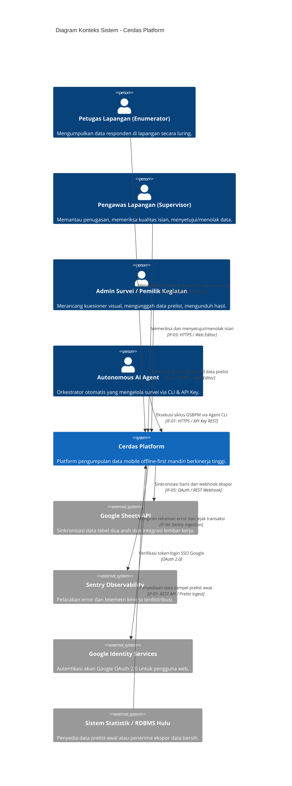

# 3. Konteks dan Cakupan (Context and Scope)

> [!INFO] **Architecture Provenance & Freshness**
> - **Verified Commit**: `4088c01` (branch: `main`)
> - **Verified Timestamp**: `2026-11-04T19:30:00+07:00`
> - **Tracked Paths**: `apps/`, `packages/`
> - **Drift Status**: `verified`

Dokumen ini mendefinisikan batasan sistem platform **Cerdas**, interaksi antarmuka eksternal, dan batasan domain fungsional.

---

## 3.1 Diagram Konteks Sistem (Mermaid C4 Context)

---

## 3.2 Antarmuka Eksternal Sistem (External Interfaces)

Berikut adalah daftar antarmuka formal yang menghubungkan komponen platform Cerdas dengan ekosistem luar:

| ID Interface | Nama Antarmuka | Protokol / Format | Deskripsi & Komponen Pengguna |
|:---|:---|:---|:---|
| IF-01 | Agent-First Programmatic REST API & CLI | HTTPS / JSON REST API | Antarmuka otomatisasi untuk AI Agent dan sistem eksternal (`/api/agent/v1`, `/api/apps`, `/api/assignments`, `/api/tables`) menggunakan autentikasi API Key (`X-Api-Key` atau `X-Super-Admin-Key`) dengan pencatatan audit log mutasi data. |
| IF-02 | Mobile Enumeration Delta Sync API | HTTPS / JSON Delta Sync | Antarmuka sinkronisasi dua arah antara aplikasi mobile offline (`apps/client`) dan backend server, mendukung kursor pagination, transfer kompresi, dan penanganan konflik pemutakhiran data. |
| IF-03 | Web Visual Editor & Dashboard API | HTTPS / JSON REST API | Antarmuka manajemen kuesioner visual, perancangan skema tabel, peninjauan data isian responden, dan tata kelola anggota kegiatan untuk pengguna peramban web (`apps/editor`). |
| IF-04 | Real-Time Messaging & Signaling Service | WebSocket (Pusher Protocol) | Antarmuka pengiriman sinyal real-time dan notifikasi perubahan status penugasan via Laravel Reverb engine. |
| IF-05 | Google Sheets Bi-Directional Sync Gateway | HTTPS / REST & Webhooks | Antarmuka integrasi eksternal untuk sinkronisasi otomatis antara tabel Cerdas dan Google Spreadsheet pengguna. |
| IF-06 | Sentry Distributed Error & Telemetry Ingestion | HTTPS / Sentry Protocol | Antarmuka telemetri dan audit kesehatan aplikasi terdistribusi di backend Octane, web editor, dan client mobile. |
