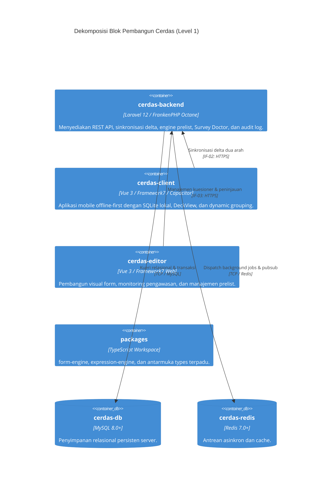

# 5. Tampilan Blok Pembangun (Building Block View)

> [!INFO] **Architecture Provenance & Freshness**
> - **Verified Commit**: `159f382` (branch: `main`)
> - **Verified Timestamp**: `2026-11-08T16:37:37+07:00`
> - **Tracked Paths**: `apps/`, `packages/`, `scripts/`
> - **Drift Status**: `verified`

Dokumen ini menguraikan dekomposisi hierarki modul dan komponen penyusun platform **Cerdas** berdasarkan model C4 Level 1 dan Level 2.

---

## 5.1 Dekomposisi Sistem Level 1 (Whitebox Overall System)

---

## 5.2 Tabel Komponen Blok Pembangun & Antarmuka

| Komponen | Deskripsi & Lokasi Sumber | Antarmuka Terkait |
|:---|:---|:---|
| cerdas-backend | Server API utama berbasis Laravel 12 & FrankenPHP Octane (`apps/backend`) yang melayani mutasi data, alur persetujuan, sinkronisasi delta, dan audit kesiapan survei (`AgentDoctorController`, `AgentAppController`, `AgentDataController`, `AssignmentController`). | IF-01, IF-02, IF-03, IF-05, IF-06 |
| cerdas-client | Aplikasi mobile enumerator offline-first berbasis Vue 3 + Framework7 + SQLite (`apps/client`) untuk perekaman data lapangan, navigasi auto-selected view, dan flat DeckView fallback (`AppShell.vue`, `useAppShellLogic`, `useAppMetadata`, `useGroupingLogic`). | IF-02, IF-06 |
| cerdas-editor | Dasbor web SPA berbasis Vue 3 (`apps/editor`) untuk perancangan kuesioner visual, tata kelola prelist, dan peninjauan data responden. | IF-03, IF-06 |
| cerdas-reverb | Server perpesanan real-time berbasis Laravel Reverb (`apps/backend/routes/channels.php`) untuk notifikasi instan perubahan status penugasan. | IF-04 |
| cerdas-queue | Pekerja antrean latar belakang (*background queue worker*) untuk ekspor data besar dan sinkronisasi eksternal Google Sheets. | IF-05 |
| cerdas-cli | Antarmuka baris perintah deterministik ramah AI Agent (`scripts/cerdas-cli`) untuk orkestrasi kegiatan, CRUD prelist, dan remediasi otomatis doctor (`--fix`). | IF-01 |
| cerdas-db | Basis data relasional MySQL 8.0+ untuk penyimpanan persisten entitas apps, tables, table_versions, assignments, responses, dan users. | Internal RDBMS |
| cerdas-redis | In-memory key-value store Redis 7.0+ untuk manajemen session, caching performa tinggi, dan broker antrean jobs. | Internal Cache |
