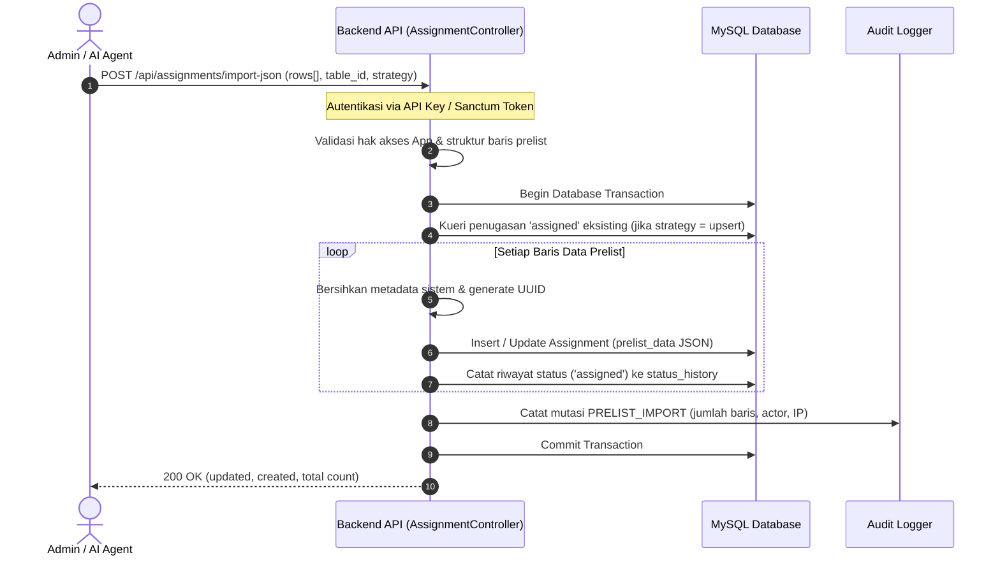
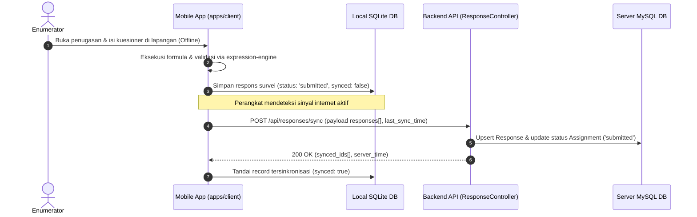
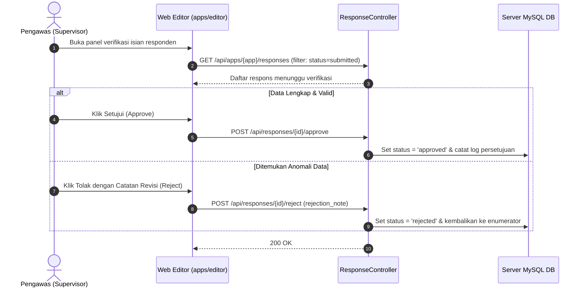

# 6. Tampilan Runtime (Runtime View)

> [!INFO] **Architecture Provenance & Freshness**
> - **Verified Commit**: `4088c01` (branch: `main`)
> - **Verified Timestamp**: `2026-11-04T19:30:00+07:00`
> - **Tracked Paths**: `apps/`, `packages/`
> - **Drift Status**: `verified`

Dokumen ini mendeskripsikan alur eksekusi dinamis dan interaksi komponen pada skenario kritis operasional pengumpulan data lapangan.

---

## 6.1 Skenario 1: Pengunggahan Data Prelist & Alokasi Penugasan (GSBPM 4.1)

Alur ketika administrator atau AI Agent memasukkan sampel data awal (prelist) ke dalam kegiatan pendataan:

---

## 6.2 Skenario 2: Operasi Enumerasi Luring & Sinkronisasi Delta (GSBPM 4.2 & 4.3)

Alur ketika enumerator mengisi kuesioner tanpa jaringan, kemudian menyinkronkan data:

---

## 6.3 Skenario 3: Peninjauan & Persetujuan Data oleh Pengawas (GSBPM 5.1 & 5.2)

Pada kegiatan dengan *Complex Mode*, data yang diserahkan enumerator melalui verifikasi supervisor:

