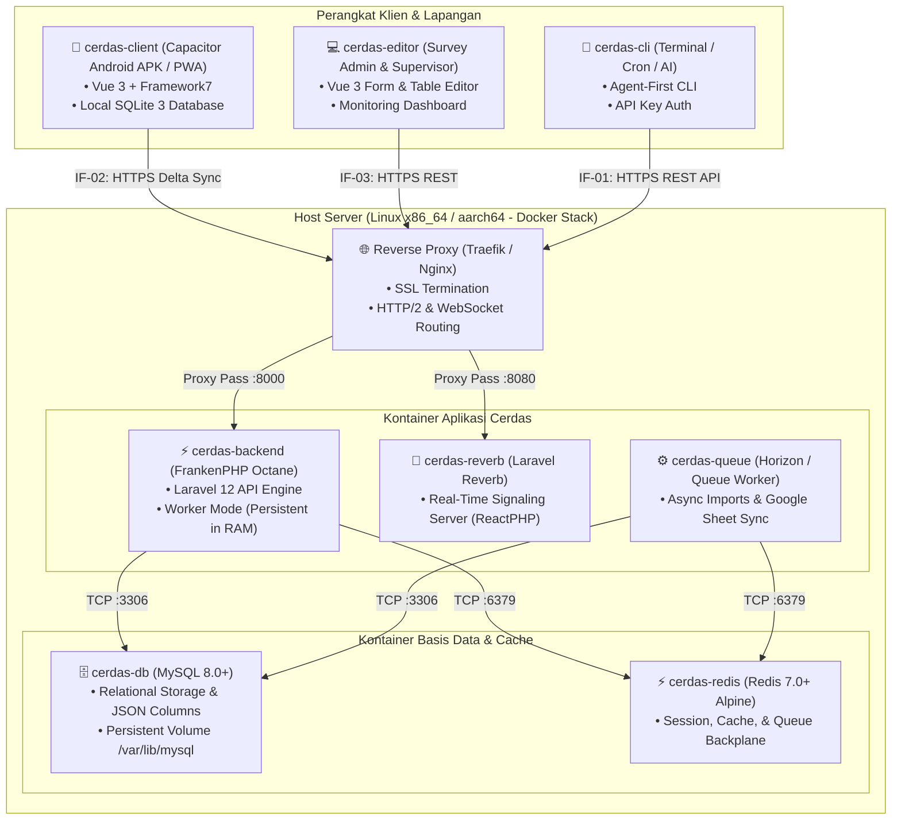

# 7. Tampilan Deployment (Deployment View)

> [!INFO] **Architecture Provenance & Freshness**
> - **Verified Commit**: `1e60f1c` (branch: `main`)
> - **Verified Timestamp**: `2026-11-07T06:14:17+07:00`
> - **Tracked Paths**: `apps/`, `packages/`, `scripts/`
> - **Drift Status**: `verified`

Dokumen ini memetakan komponen perangkat lunak Cerdas ke infrastruktur fisik, virtual, dan topologi kontainer.

---

## 7.1 Topologi Kontainer Docker & Orkestrator Coolify

Sistem dideploy secara mandiri (*self-hosted*) menggunakan orkestrator Coolify (Stack UUID: `q4cwk40sso0wocww4c44oso8`) pada server fisik ThinkStation (`100.101.49.42`) maupun VPS mandiri.

---

## 7.2 Spesifikasi Sumber Daya & Konfigurasi Lingkungan

Berikut pemetaan seluruh blok pembangun terhadap lingkungan eksekusi fisik atau kontainernya:

| Komponen | Lingkungan Eksekusi & Gambar Dasar | CPU / RAM Minimum | Port / Transport | Deskripsi Peran |
|:---|:---|:---|:---|:---|
| **cerdas-backend** | Kontainer Docker `dunglas/frankenphp:latest-php8.2` | 1 Core / 512 MB | `8000` (HTTP) | Melayani REST API dalam worker-mode Octane. |
| **cerdas-client** | Perangkat Android (APK) / PWA Browser Enumerator | 2 GB RAM Device | `IF-02` (HTTPS Sync) | Aplikasi mobile offline-first dengan basis data SQLite lokal. |
| **cerdas-editor** | SPA Web Browser (Chrome/Firefox/Safari) Admin | N/A (Client Machine) | `IF-03` (HTTPS REST) | Dasbor web untuk merancang form visual dan verifikasi data. |
| **cerdas-reverb** | Kontainer Docker `dunglas/frankenphp:latest-php8.2` | 0.5 Core / 256 MB | `8080` (WebSocket) | Server websocket real-time untuk sinyal penugasan. |
| **cerdas-queue** | Kontainer Docker `dunglas/frankenphp:latest-php8.2` | 0.5 Core / 256 MB | N/A | Pemroses antrean background (ekspor Excel, sinkronisasi Google Sheet). |
| **cerdas-cli** | Host Terminal / Shell Environment (CLI executable) | N/A (Lightweight) | `IF-01` (HTTPS API) | Kakas baris perintah otomatisasi untuk agen AI dan cron jobs. |
| **cerdas-db** | Kontainer Docker `mysql:8.0` / `mariadb:10.11` | 1 Core / 1024 MB | `3306` (TCP) | Penyimpanan data relasional dan arsip respons survei. |
| **cerdas-redis** | Kontainer Docker `redis:7-alpine` | 0.5 Core / 128 MB | `6379` (TCP) | Broker antrean pesan asinkron dan memory caching. |
