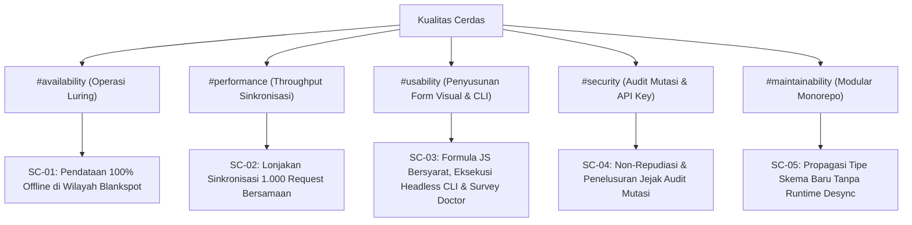

# 10. Persyaratan Mutu (Quality Requirements)

> [!INFO] **Architecture Provenance & Freshness**
> - **Verified Commit**: `1e60f1c` (branch: `main`)
> - **Verified Timestamp**: `2026-11-07T06:14:17+07:00`
> - **Tracked Paths**: `apps/`, `packages/`, `scripts/`
> - **Drift Status**: `verified`

Dokumen ini menguji sasaran mutu arsitektur yang didefinisikan pada Bagian 1 melalui skenario mutu konkret berbasis model kualitas Q42.

---

## 10.1 Pohon Mutu & Skenario Kualitas (Quality Tree)

---

## 10.2 Matriks Skenario Mutu Konkret

| ID Skenario | Tag Mutu | Kondisi Stimulus | Respons Sistem & Batas Toleransi Terukur |
|:---|:---|:---|:---|
| **SC-01** | #availability | Perangkat enumerator berada di wilayah blankspot tanpa sinyal seluler selama 8 jam operasional penuh. | Aplikasi mobile klien tetap berfungsi 100% normal; seluruh pembacaan prelist, pengisian data, kalkulasi formula matematika, dan tangkapan koordinat GPS disimpan secara persisten di SQLite lokal tanpa kehilangan satu pun entri data. |
| **SC-02** | #performance | 500 enumerator melakukan sinkronisasi delta serentak dalam rentang waktu 60 detik di akhir jam kerja. | FrankenPHP Octane memproses seluruh payload sinkronisasi delta dengan tingkat keberhasilan >99.9%, latensi respon p95 < 250ms, dan penggunaan CPU server stabil di bawah 80%. |
| **SC-03** | #usability | Administrator merancang kuesioner kompleks dengan 50 variabel, 10 aturan lompatan *Show If*, dan 5 kalkulasi *Formula*, atau agen AI menjalankan audit kesiapan survei. | Editor web menyajikan antarmuka visual responsif dengan pratinjau real-time; formula dievaluasi secara instan (<2ms) dalam sandbox aman; AI Agent dapat mereplikasi instrumen via CLI JSON; dan endpoint Survey Doctor memvalidasi seluruh kesiapan kegiatan dalam latensi agregasi <100ms. |
| **SC-04** | #security | Pengguna memanggil endpoint mutasi (pengunggahan prelist, penugasan ulang enumerator, atau persetujuan isian) via API Key. | Sistem memvalidasi hash SHA-256 kunci API secara konstan, memastikan hak akses ke App bersangkutan, dan mencatat rincian audit log lengkap (Aktor, IP, Timestamp, Perubahan) sebelum mengembalikan status 200 OK. |
| **SC-05** | #maintainability | Penambahan tipe data field kuesioner baru pada paket `@cerdas/types`. | Perubahan tipe data langsung terdeteksi oleh kompilasi TypeScript pada `apps/editor` dan `apps/client` tanpa perlu langkah *build-and-publish* eksternal; mencegah inkonsistensi tipe data di seluruh monorepo. |
